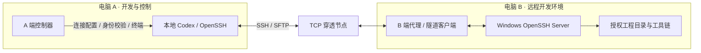
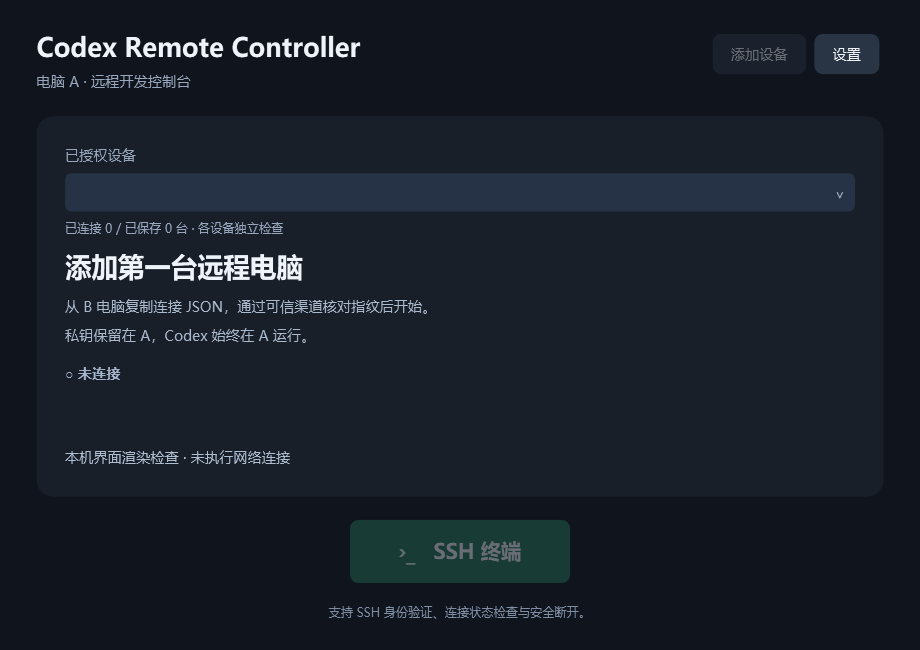
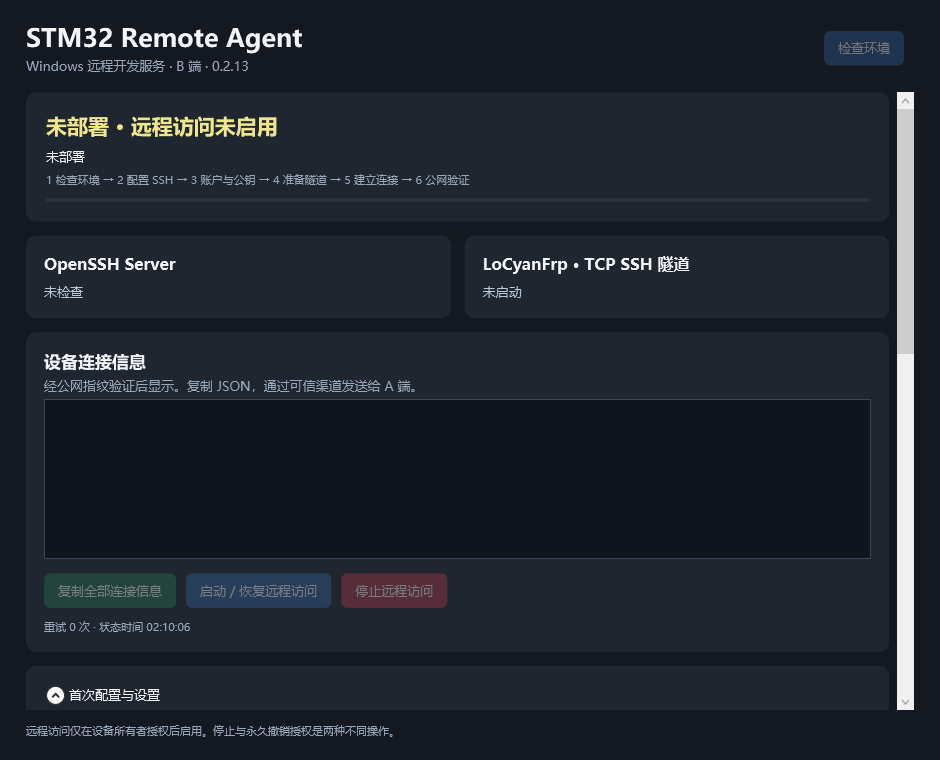

# CodeLink

### Windows 多设备远程开发助手

**在电脑 A 开发，让电脑 B 的工程、终端与工具链成为可访问的远程环境。**

CodeLink 将中文桌面控制器、Windows SSH 访问部署和 TCP 隧道管理组合在一起，帮助你从本地连接自己的远程 Windows 电脑。需要配合 Codex 时，Codex 运行在 A，B 无需安装 Codex、Node.js 或 OpenAI 组件。

> **项目介绍预览**：本仓库当前只包含项目说明、架构说明、验证状态和界面图片，**尚未上传程序源码或安装包**。下文介绍的是本地开发项目的当前能力与验证范围，不表示仓库已经提供可下载运行的版本。

[项目用途](#为什么做-codelink) · [工作方式](#工作方式) · [功能介绍](#功能介绍) · [界面预览](#界面预览) · [验证状态](docs/验证状态.md) · [架构与功能](docs/架构与功能.md)

## 为什么做 CodeLink

远程开发经常需要反复处理几个问题：目标电脑在内网、SSH 环境没有准备好、设备地址会变化、密钥和主机身份需要核实，多台电脑的连接状态也容易混淆。

CodeLink 希望把这些准备和连接管理步骤整理成一个明确的 A/B 工作流程：

- **开发在 A**：保留本地 Codex 和日常操作入口，通过命令访问远端工程。
- **环境在 B**：保留工程、编译器和相关工具，按所有者授权提供远程访问。
- **设备分别管理**：每台 B 使用独立身份、隧道端点、连接记录和状态。
- **访问由所有者控制**：B 可以明确停止、恢复或撤销访问。

项目起于 Windows 与 STM32 远程开发需求，也适用于能够通过 SSH 命令和 SFTP 文件传输开展工作的其他 Windows 工程。具体编译、调试和烧录仍依赖 B 上的工具链、权限和对应验证。

## 工作方式

| 组成 | 在哪里运行 | 负责什么 |
|---|---|---|
| A 端控制器 | 电脑 A | 设备导入、主机身份核验、连接状态和 SSH 终端入口 |
| B 端代理 | 电脑 B | 准备 SSH 访问、授权公钥、管理隧道、启停与撤销访问 |
| 隧道分配工具 | 电脑 A，独立于控制器 | 按设备准备绑定包与分配信息 |
| TCP 穿透节点 | 所选服务平台 | 提供内网电脑的访问路径 |

本地 Codex 的文件工具不会因为打开了 SSH 窗口就自动切换到 B。访问远程文件或执行命令时，需要使用设备说明中的 SSH/SFTP 命令。更多细节见[架构与功能](docs/架构与功能.md)。

## 功能介绍

| 方向 | 当前项目能力 |
|---|---|
| 设备管理 | 保存与切换多台设备，各自维护别名、信任、状态和终端 |
| SSH 接入 | 导入连接信息，核对主机指纹，以公钥认证登录普通账户 |
| 本地配置 | 维护应用专用 SSH 配置与 known_hosts，生成设备使用说明 |
| B 端部署 | 环境检查、账户与公钥授权、SSH 与隧道部署流程 |
| 生命周期 | 主动停止、明确恢复、撤销授权、覆盖升级与卸载流程 |
| 服务商适配 | LoCyanFrp、ChmlFrp，以及已保存 NATAPP 安装的兼容路径 |
| 界面与交付 | 中文 WPF 桌面界面、自包含发布与 Windows 安装包构建 |

多设备管理能力与多台真实设备公网验收分别记录；本项目不提供穿透节点，也不承诺服务商免费配额、带宽或五台设备真实并发。

## 界面预览

### A 端 · 管理设备与进入终端

### B 端 · 部署环境与管理访问

图片来自已有的离线界面渲染，展示空设备、未部署状态，**不是公网在线截图**。图中保留了组件原名称 Codex Remote Controller / STM32 Remote Agent；CodeLink 为整个 A/B 项目的名称。

## 使用流程是什么样的

程序发布后，基本流程为：

1. A 准备控制器与 OpenSSH 客户端，取得用于授权的 SSH 公钥，私钥留在 A。
2. B 所有者安装代理，取得设备标识。
3. 使用 A 侧分配工具，为该 B 准备独立隧道绑定包。
4. B 导入绑定包和 A 公钥，确认部署并开启远程访问。
5. B 核验公网主机身份后，导出连接 JSON，经可信渠道交给 A。
6. A 导入信息、核对指纹并验证登录，然后打开 SSH 终端。
7. A 使用设备说明中的命令访问 B 的授权目录、传输文件或调用开发工具。

目标系统为 Windows 10/11 x64。具体组件准备、管理员操作、网络与隧道条件需满足对应要求；完整跨 Windows 版本安装矩阵仍待验证。

## 项目进展与验证范围

介绍依据为 2026-10-23 已核对的本地版本记录：**A 1.1.4 / B 0.2.13**。这些是本地开发版本，不是本仓库的已发布 Release。

- A 有离线/模拟、本机集成及五个回环 SSH 服务的测试记录。
- B 0.2.13 有 Release 构建与 214 项自动测试通过的记录；新版实机升级和后台状态观察仍待完成。
- 历史 B 0.2.11 / ChmlFrp 有单机公网登录、保守 SFTP 和部分生命周期的实测记录。
- B 0.2.12 有清理后手动首次安装，以及公网普通账户登录、1 MiB 中文文件名 SFTP 往返的记录。
- 双机/五机公网、其他服务商公网、默认大文件、长会话和具体工程完整开发闭环仍有待验收项。

这些结果引用现有项目记录，本次文档预览没有重新执行构建或实机测试。完整说明见[验证状态](docs/验证状态.md)。

## 连接与授权边界

- 连接 JSON 不携带运行 Token、SSH 私钥或工程路径；部署绑定包可能含凭据，应按秘密资料保管。
- 主机指纹变化需要重新核实身份，不能自动覆盖已有信任。
- A 的“断开”管理本应用的会话与检查；关闭 B 的访问、撤销授权由 B 所有者执行。
- B 主动停止后需要明确恢复，A 打开界面不会自动替 B 启用访问。
- 单隧道配置不代表平台账号凭据自动缩小到单隧道权限。

当前界面没有通用文件管理、一键编译烧录或完整构建日志工作台。这些操作依赖明确的远端命令与对应工具链。

## 后续计划

- [x] 发布项目介绍、架构说明和离线界面预览。
- [ ] 完成源码、测试夹具、文档及第三方文件的公开整理与许可核对。
- [ ] 完善全新机器的依赖准备、构建和使用说明，再公开源码。
- [ ] 补全新版 B 与 A 界面的实机交互验收。
- [ ] 提供带版本说明与校验摘要的安装包预览。
- [ ] 在首次发布流程稳定后接入 GitHub 检查和审查自动化。

## 下载与源码

**本次只发布介绍预览，暂无源码或安装包下载。**后续开放内容会在此说明；程序安装包将按版本放到 Releases。

自有代码许可证尚未选定，因此当前不声明源码采用 MIT、Apache-2.0 或其他许可。第三方组件保留各自版权与许可，公开源码和分发二进制时分别核对。

## 反馈

欢迎通过 [Issues](https://github.com/atct567-droid/CodeLink/issues) 对项目定位、介绍和功能提出建议。涉及连接问题时，仅提供脱敏后的版本、步骤、截图和错误摘要，不提交 Token、私钥、真实绑定包或完整设备配置。

维护者：[atct567-droid](https://github.com/atct567-droid)。本项目为独立开发项目，产品与平台名称仅用于说明集成关系。
